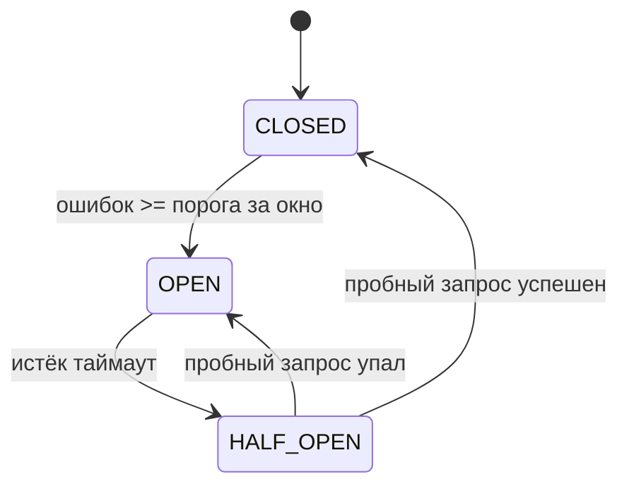

# Circuit Breaker для Flight Service

## Зачем нужен

Если Flight Service недоступен, каждый запрос Booking Service ждёт retry и таймаут.
Circuit Breaker быстро отдаёт ошибку, пока сервис восстанавливается, и не создаёт лишнюю нагрузку.

## Состояния



- **CLOSED**: запросы идут в Flight Service
- **OPEN**: запросы сразу завершаются ошибкой без вызова Flight Service
- **HALF_OPEN**: пропускается один пробный запрос

Переход OPEN → HALF_OPEN выполняется лениво, при следующем запросе после истечения таймаута.

## Параметры

| Переменная | По умолчанию | Значение |
|---|---|---|
| `CIRCUIT_BREAKER_FAILURE_THRESHOLD` | `5` | сколько ошибок открывают breaker |
| `CIRCUIT_BREAKER_OPEN_TIMEOUT` | `15s` | сколько breaker остаётся открытым |
| `CIRCUIT_BREAKER_WINDOW` | `30s` | окно, в котором считаются ошибки |

Ошибки считаются в скользящем окне.
Старые ошибки за пределами окна не учитываются.

## Какие ошибки считаются сбоем

Сбоем считаются только технические ошибки:

- `UNAVAILABLE`
- `DEADLINE_EXCEEDED`
- `INTERNAL`
- `UNKNOWN`

Бизнес-ошибки не открывают breaker:

- `INVALID_ARGUMENT`
- `NOT_FOUND`
- `RESOURCE_EXHAUSTED`
- `ALREADY_EXISTS`
- `FAILED_PRECONDITION`
- `UNAUTHENTICATED`
- `PERMISSION_DENIED`

В HALF_OPEN бизнес-ошибка означает, что сервис ответил, поэтому breaker закрывается.

## Порядок интерсепторов

`cmd/booking/main.go`

```go
grpc.WithChainUnaryInterceptor(
    auth.UnaryClientInterceptor(cfg.FlightAPIKey),
    breaker.UnaryInterceptor(),
    booking.UnaryRetryInterceptor(booking.DefaultRetryConfig()),
)
```

`breaker` стоит перед `retry`, поэтому:

- одна логическая ошибка считается один раз, а не по одной на каждую retry-попытку
- в OPEN запрос не доходит до retry и завершается сразу
- в HALF_OPEN пробный запрос может использовать retry

## Ошибка в состоянии OPEN

Breaker возвращает gRPC-код `UNAVAILABLE`:

```
flight service unavailable: circuit breaker is open
```

`internal/booking/http.go` уже преобразует `UNAVAILABLE` в HTTP `503 Service Unavailable`.
Клиент получает ответ сразу, без ожидания таймаута.

## Логи

```
circuit breaker CLOSED -> OPEN: 5 failures in 30s
circuit breaker OPEN -> HALF_OPEN: timeout 15s elapsed
circuit breaker HALF_OPEN -> CLOSED: probe succeeded
circuit breaker HALF_OPEN -> OPEN: probe failed: rpc error: code = Unavailable
```

## Реализация

`internal/booking/circuitbreaker.go`

- `CircuitBreakerConfig{FailureThreshold, OpenTimeout, Window}`
- `NewCircuitBreaker` и `UnaryInterceptor`
- состояние защищено `sync.Mutex`
- история ошибок хранится как метки времени
- в HALF_OPEN одновременно разрешён только один пробный запрос

## Проверка

```bash
docker compose up -d --build
curl http://localhost:8080/flights/00000000-0000-0000-0000-000000000001
```

Остановить Flight Service:

```bash
docker compose stop flight-service
curl http://localhost:8080/flights/00000000-0000-0000-0000-000000000001
```

Повторить запрос несколько раз.
После порога ошибок в логах появится `CLOSED -> OPEN`, а ответом станет `503`.

Вернуть Flight Service:

```bash
docker compose start flight-service
```

После `OPEN_TIMEOUT` следующий запрос пройдёт проверку HALF_OPEN и закроет breaker.

## Ограничения

Состояние breaker хранится в памяти процесса Booking Service.
При нескольких экземплярах Booking Service у каждого будет свой breaker.
Для распределённого состояния нужен внешний стор или отдельный сервис.
