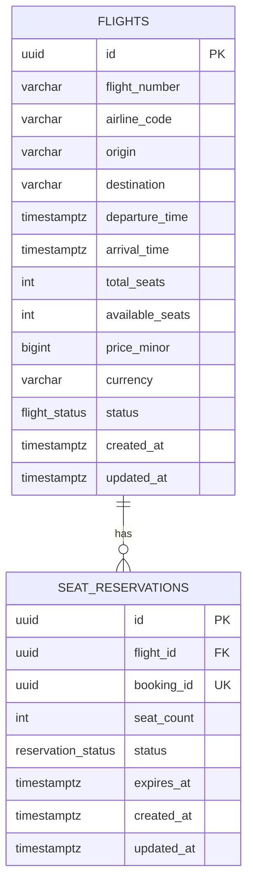
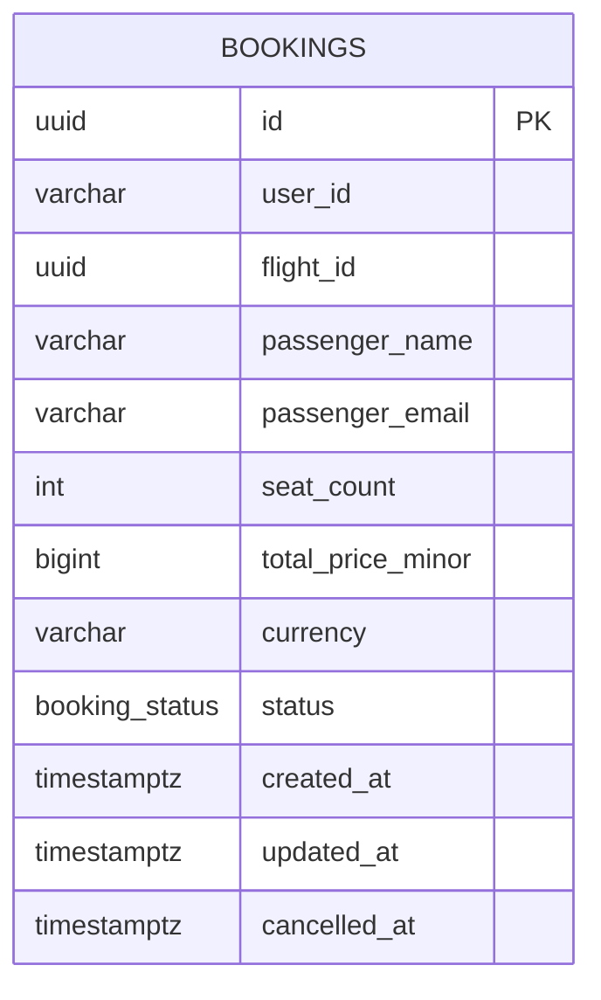

# ER-диаграмма (3NF)

Две независимые БД: `flight_db` и `booking_db`
Между БД нет FK, ссылка `bookings.flight_id` проверяется через gRPC

Источник: `proto/flight/v1/flight.proto`
Деньги хранятся в минорных единицах: `price_minor`, `total_price_minor`
Уникальность рейса: номер + дата вылета по UTC

## Flight Service

### flights

| Поле | Тип | Описание |
|---|---|---|
| id | uuid | первичный ключ |
| flight_number | varchar(10) | номер рейса |
| airline_code | varchar(3) | код авиакомпании |
| origin | varchar(3) | IATA код вылета |
| destination | varchar(3) | IATA код прилёта |
| departure_time | timestamptz | время вылета |
| arrival_time | timestamptz | время прилёта |
| total_seats | int | всего мест |
| available_seats | int | доступно мест |
| price_minor | bigint | цена в минорных единицах |
| currency | varchar(3) | валюта ISO 4217 |
| status | flight_status | SCHEDULED, DEPARTED, CANCELLED, COMPLETED |
| created_at | timestamptz | создание |
| updated_at | timestamptz | изменение |

### seat_reservations

| Поле | Тип | Описание |
|---|---|---|
| id | uuid | первичный ключ |
| flight_id | uuid | FK на flights |
| booking_id | uuid | бронирование из Booking Service |
| seat_count | int | зарезервировано мест |
| status | reservation_status | ACTIVE, RELEASED, EXPIRED |
| expires_at | timestamptz | истечение, опционально |
| created_at | timestamptz | создание |
| updated_at | timestamptz | изменение |

## Booking Service

### bookings

| Поле | Тип | Описание |
|---|---|---|
| id | uuid | первичный ключ |
| user_id | varchar(64) | пользователь |
| flight_id | uuid | рейс во Flight Service |
| passenger_name | varchar(200) | имя пассажира |
| passenger_email | varchar(254) | email пассажира |
| seat_count | int | количество мест |
| total_price_minor | bigint | снапшот стоимости |
| currency | varchar(3) | валюта ISO 4217 |
| status | booking_status | CONFIRMED, CANCELLED |
| created_at | timestamptz | создание |
| updated_at | timestamptz | изменение |
| cancelled_at | timestamptz | отмена, опционально |

## Межсервисная ссылка

`bookings.flight_id` ссылается на `flights.id` логически
Физический FK невозможен из-за раздельных БД
Целостность обеспечивают `GetFlight` и `ReserveSeats`

`seat_reservations.booking_id` ссылается на `bookings.id` логически
Уникальный индекс защищает от дублей при retry

## Ограничения

| Таблица | Ограничение |
|---|---|
| flights | `total_seats > 0` |
| flights | `available_seats >= 0` |
| flights | `available_seats <= total_seats` |
| flights | `price_minor > 0` |
| flights | `arrival_time > departure_time` |
| flights | `origin <> destination` |
| flights | `origin ~ '^[A-Z]{3}$'` |
| flights | `destination ~ '^[A-Z]{3}$'` |
| flights | `currency ~ '^[A-Z]{3}$'` |
| seat_reservations | `seat_count > 0` |
| bookings | `seat_count > 0` |
| bookings | `total_price_minor > 0` |
| bookings | `currency ~ '^[A-Z]{3}$'` |
| bookings | `passenger_email <> ''` |

## Уникальность и индексы

| Таблица | Объект |
|---|---|
| flights | unique `(flight_number, ((departure_time AT TIME ZONE 'UTC')::date))` |
| flights | index `(origin, destination, departure_time)` |
| flights | index `(status)` |
| seat_reservations | unique `(booking_id)` |
| seat_reservations | index `(flight_id, status)` |
| bookings | index `(user_id)` |
| bookings | index `(flight_id)` |

## Обоснование 3NF

- Каждый неключевой атрибут зависит от первичного ключа
- Нет повторяющихся групп и массивов в полях
- В `flights` только IATA-коды, без названий городов и авиакомпаний
- В `bookings` нет копии данных рейса, только `flight_id`
- `total_price_minor` это снапшот на момент бронирования, а не вычисление из текущей цены
- `available_seats` это счётчик бизнес-состояния, согласованность через транзакции
- `booking_id` уникален, одна резервация на одно бронирование
